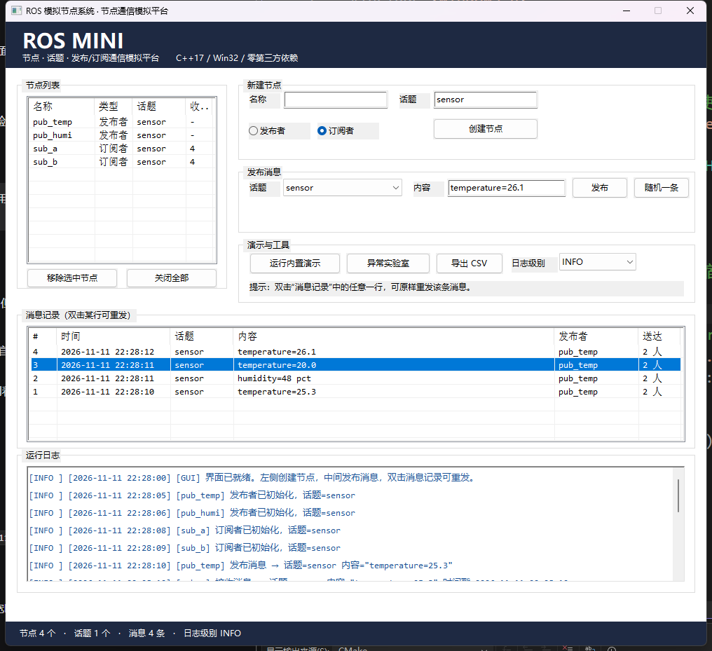

# ROS 模拟节点系统（ros_mini）

用 **C++17** 在单进程内实现的 ROS 核心通信模型：节点（Node）、话题（Topic）、消息（Message）、
发布者（Publisher）、订阅者（Subscriber）与单例核心管理模块（ROS）。

本项目不依赖真实 ROS 运行时，也不使用 roscpp 等官方 API，而是用标准 C++ 复现「节点—话题」
松耦合发布/订阅的通信逻辑，用于练习面向对象抽象、STL 容器、对象生命周期管理与异常处理。

提供两种使用方式：**Win32 图形界面**（鼠标操作）与**控制台批量演示**（一次性输出全部日志）。

---

## 功能特性

- **图形界面**：Win32 原生窗口，无需 Qt/MFC；左侧节点列表、右侧操作区、底部实时日志
- 节点抽象基类：封装唯一名称（只读）、定义 `init()` / `shutdown()` 纯虚接口
- 发布者：持有话题名，接收传感器字符串 → 创建消息 → 输出日志 → 交给核心转发
- 订阅者：持有话题名，被动接收消息并打印「内容 + 时间戳」
- 消息：字符串内容 + 构造时自动生成的时间戳（`YYYY-MM-DD HH:MM:SS`），对外只读
- 核心模块：单例，维护「话题→发布者」「话题→订阅者」两张映射表，按话题一对多转发
- 界面支持运行期**动态增删节点**（注销后从映射表移除，不产生悬空指针）
- 异常体系：`NodeException` / `TopicException` / `MessageException`，非法输入不崩溃
- 分级日志：`INFO` / `WARN` / `ERROR`，同时输出到界面、控制台与 `rosmini.log`

---

## 目录结构

```
ros_mini/
├── CMakeLists.txt
├── include/rosmini/          对外头文件
│   ├── Exception.h           异常体系
│   ├── Logger.h              分级日志（支持界面回调）
│   ├── Message.h             消息载体
│   ├── Node.h                节点抽象基类
│   ├── Publisher.h           发布者
│   ├── Subscriber.h          订阅者
│   ├── ROS.h                 核心管理单例
│   ├── GuiApp.h              图形界面（Win32）
│   └── Util.h                时间戳与字符串工具
├── src/
│   ├── main.cpp              图形界面入口（WinMain）
│   ├── batch_main.cpp        控制台演示入口
│   ├── GuiApp.cpp            界面实现
│   └── （其余为各模块实现）
├── tests/                    结构化测试（可执行）+ 测试用例表
└── docs/                     需求、架构、技术文档、用户手册
```

---

## 快速开始

### 方式一：Visual Studio（推荐）

1. `文件 → 打开 → 文件夹`，选择本仓库根目录
2. 等待 CMake 自动配置完成
3. 顶部启动项选择 **`rosmini_demo.exe`**，按 **F5** —— 会直接弹出图形界面窗口

### 方式二：命令行

```bash
cmake -S . -B build -G Ninja -DCMAKE_BUILD_TYPE=Release
cmake --build build

build/rosmini_demo     # 图形界面（Windows 下为 build\rosmini_demo.exe）
build/rosmini_batch    # 控制台批量演示
build/rosmini_tests    # 运行测试
```

### 构建产物

| 目标 | 类型 | 说明 |
|---|---|---|
| `rosmini_core` | 静态库 | 全部核心实现，被三个程序共用 |
| `rosmini_demo` | 图形程序（WIN32） | 交互式界面，答辩演示用 |
| `rosmini_batch` | 控制台程序 | 一次性输出全部日志，截图/命令行验证用 |
| `rosmini_tests` | 控制台程序 | 9 组用例、21 项检查 |

---

## 图形界面



```
┌──────────────────────────────────────────────────────────┐
│ ROS MINI   节点 · 话题 · 发布/订阅通信模拟平台            │
├───────────────┬──────────────────────────────────────────┤
│ 节点列表       │ 新建节点：名称/话题 + 发布者/订阅者       │
│ gui_pub [发布]│ 发布消息：话题下拉 + 内容 + 发布/随机     │
│ gui_sub [订阅]│ 演示与工具：内置演示/异常实验室/日志级别   │
├───────────────┴──────────────────────────────────────────┤
│ 消息记录（# / 时间 / 话题 / 内容 / 发布者 / 送达，双击重发）│
├──────────────────────────────────────────────────────────┤
│ 运行日志（按级别着色，可滚动）                             │
├──────────────────────────────────────────────────────────┤
│ 节点 2 个 · 话题 1 个 · 消息 3 条 · 日志级别 INFO          │
└──────────────────────────────────────────────────────────┘
```

可完成的操作：

1. **创建节点**：填名称与话题，选「发布者/订阅者」，点「创建节点」
2. **发布消息**：从下拉框选话题、输入内容（或点「随机一条」自动生成），点「发布」
3. **查看消息记录**：每次发布成功都在「消息记录」表里新增一行，含序号、时间、话题、内容、
   发布者、送达人数；**双击任意一行即可原样重发**
4. **移除节点**：在左侧列表选中后点「移除选中节点」（动态注销，对应需求 FR-16）
5. **运行内置演示**：自动跑「2 发布者 + 2 订阅者」的多对多场景
6. **异常实验室**：依次触发 6 种非法操作，观察每一条都被捕获、程序不崩溃
7. **导出 CSV**：把消息记录导出为 `messages.csv`（UTF-8，Excel 可直接打开）
8. **日志着色**：INFO 蓝、WARN 橙、ERROR 红；可按级别切换只显示 WARN/ERROR

---

## 运行效果

### 图形界面日志

```
[INFO ] [2026-11-11 22:06:13] [gui_pub] 发布者已初始化，话题=sensor
[INFO ] [2026-11-11 22:06:15] [gui_sub] 订阅者已初始化，话题=sensor
[INFO ] [2026-11-11 22:06:16] [gui_pub] 发布消息 → 话题=sensor 内容="temperature=30.5"
[INFO ] [2026-11-11 22:06:16] [gui_sub] 接收消息 ← 话题=sensor 内容="temperature=30.5" 时间戳=2026-11-11 22:06:16
```

### 控制台演示（`rosmini_batch.exe`）

```
[INFO ] [2026-11-11 21:44:22] [pub_temp] 发布消息 → 话题=sensor 内容="temperature=25.3"
[INFO ] [2026-11-11 21:44:22] [sub_a] 接收消息 ← 话题=sensor 内容="temperature=25.3" 时间戳=2026-11-11 21:44:22
[INFO ] [2026-11-11 21:44:22] [sub_b] 接收消息 ← 话题=sensor 内容="temperature=25.3" 时间戳=2026-11-11 21:44:22
[ERROR] [2026-11-11 21:44:22] [main] 已捕获：[TopicException] 话题不存在："ghost_topic" 尚未注册任何订阅者
[INFO ] [2026-11-11 21:44:22] [main] ===== 演示结束，全部异常均已捕获，程序正常退出 =====
```

### 测试

```
检查项：21 个，失败：0 个
全部用例通过
```

---

## 文档

| 文档 | 内容 |
|---|---|
| [需求文档](docs/01-需求文档.md) | 功能/非功能需求、异常场景、验收标准 |
| [架构设计文档](docs/02-架构设计文档.md) | 分层、类图、时序图、关键设计决策 |
| [技术文档](docs/03-技术文档.md) | 实现细节、踩坑记录、取舍分析 |
| [用户手册](docs/04-用户手册.md) | 编译、运行、扩展与常见问题 |
| [测试用例表](tests/测试用例表.md) | 12 个用例，覆盖正常/边界/异常 |

---

## 开发环境

| 项 | 版本 |
|---|---|
| 操作系统 | Windows 11 |
| IDE | Visual Studio 2026（Community） |
| 编译器 | MSVC 14.51 |
| 构建 | CMake 4.3.1 + Ninja |
| 语言标准 | C++17 |
| 依赖 | 仅标准库与 Win32 API（界面部分） |

---

## 作者

蔡劭恒 · 2026-11-11
